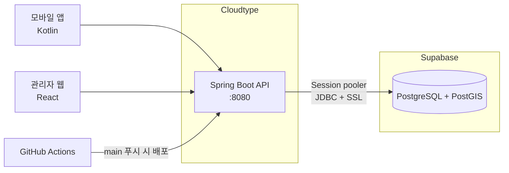
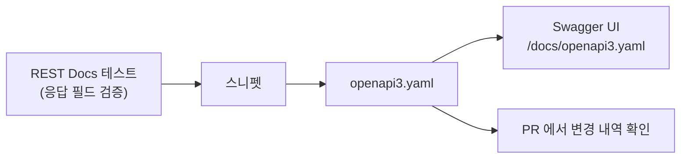
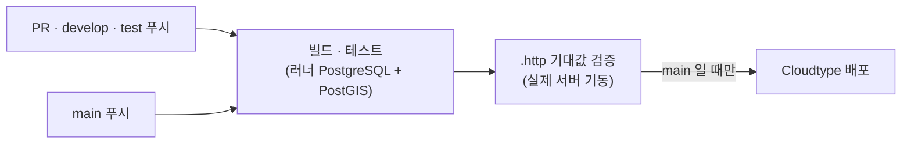

# 다시, 시흥 · 백엔드

> 빈 상가를 짧은 판매·전시 공간으로 연결하는 서비스

시흥 정왕동·거북섬·배곧의 빈 상가와 팝업·전시·체험 공간이 필요한 대학생, 예비 창업자, 지역 창작자를 연결합니다.
이 저장소는 모바일 앱(Kotlin)과 관리자 웹(React)이 함께 사용하는 **API 서버**입니다.

| 핵심 기능 (P0) | 백엔드 책임 |
| --- | --- |
| 공간 등록 · 관리자 검수 | 권한 증빙 제출, 검수 결과(공개 승인 / 수정 요청 / 공개 보류) |
| 지도 · 목록 탐색 | PostGIS 좌표 저장, 지역·날짜·예산·활동 필터 검색 |
| 신청 · 승인 · 상태 조회 | **승인 시점에만 확정**, 기간이 겹치는 대기 신청은 같은 트랜잭션에서 자동 마감 |
| 계정 · 역할 | 이용자 / 공간 제공자 / 관리자 역할별 접근 제어 |

---

## 목차

1. [기술 스택](#기술-스택)
2. [시스템 구성](#시스템-구성)
3. [프로젝트 구조](#프로젝트-구조)
4. [로컬 실행](#로컬-실행)
5. [API 문서와 협업](#api-문서와-협업)
6. [응답 형식](#응답-형식)
7. [테스트](#테스트)
8. [CI/CD](#cicd)
9. [배포 준비 (Supabase · Cloudtype)](#배포-준비-supabase--cloudtype)
10. [문제 해결](#문제-해결)

---

## 기술 스택

| 구분 | 사용 기술 |
| --- | --- |
| 언어 · 프레임워크 | Java 21, Spring Boot 3.5.16 |
| 데이터 | PostgreSQL 17, PostGIS 3.5, Spring Data JPA, Hibernate Spatial, Flyway |
| 보안 | Spring Security (Stateless, JWT 예정) |
| API 문서 | springdoc(Swagger UI), Spring REST Docs → OpenAPI 3 (`openapi3.yaml`) |
| 테스트 | JUnit 5, MockMvc, Spring REST Docs, ArchUnit, IntelliJ HTTP Client |
| 빌드 · 배포 | Gradle 8.14, GitHub Actions, Cloudtype(서버), Supabase(DB) |

## 시스템 구성



## 프로젝트 구조

**계층형 구조**를 사용합니다. 의존 방향은 `controller → service → repository` 한 방향이며,
`LayeredArchitectureTest`(ArchUnit)가 규칙 위반을 빌드 실패로 막습니다.

```
src/main/java/com/dasisiheung
├── controller   요청·응답 변환, 입력 검증 (비즈니스 로직 없음)
├── service      비즈니스 규칙, 트랜잭션 경계
├── repository   Spring Data JPA, PostGIS 공간 쿼리
├── entity       JPA 엔티티 (BaseTimeEntity: 생성·수정 시각 자동 기록)
├── dto          요청·응답 객체 (common: 공통 응답 형식)
├── exception    ErrorCode, BusinessException, 전역 예외 처리
├── security     보안 필터 단계의 401/403 JSON 응답
├── config       Security, CORS, JPA Auditing, Clock, OpenAPI 설정
└── util         GeoPoints (위도·경도 → WGS84 Point)

src/main/resources
├── application.yml          공통 설정
├── application-local.yml    로컬 (기본 프로필)
├── application-prod.yml     운영 (Cloudtype + Supabase)
├── db/migration             Flyway 마이그레이션 (V1: PostGIS 활성화)
└── static/docs/openapi3.yaml   테스트로 검증된 API 명세

http/                        IntelliJ HTTP Client 요청 + 기대값 검증
```

ArchUnit이 검사하는 규칙

| 규칙 | 내용 |
| --- | --- |
| 계층 방향 | Controller → Service → Repository 만 허용 (역방향·건너뛰기 금지) |
| 엔티티 독립 | `entity` 는 controller · service · dto 를 의존하지 않음 |
| 컨트롤러 위치 | `@RestController` 는 `controller` 패키지, 이름은 `~Controller` |
| 순환 금지 | 최상위 패키지 사이 순환 의존 금지 |

## 로컬 실행

### 준비물

- **JDK 21**
- **PostgreSQL + PostGIS** 중 하나
  - **Supabase 개발 프로젝트** (권장) — 설치할 것이 없습니다. 운영과 별도의 프로젝트를 하나 만들어 사용
  - 로컬 설치 — 예: Postgres.app (PostGIS 포함). 기본 접속 정보는 `localhost:5432/dasi_siheung`, `dasi / dasi`

### 1. DB 접속 정보 넣기

`.env.example` 을 `.env` 로 복사하고 `DB_URL`, `DB_USERNAME`, `DB_PASSWORD` 를 채운 뒤 IDE 실행 구성에 연결합니다.
로컬 설치 DB를 기본값 그대로 쓴다면 이 단계는 건너뛰어도 됩니다.

### 2. 서버 실행

```bash
./gradlew bootRun           # 기본 프로필: local
```

| 확인 주소 | 내용 |
| --- | --- |
| http://localhost:8080/api/v1/system/ping | 서버 연결 확인 |
| http://localhost:8080/actuator/health | 헬스 체크 (DB 포함) |
| http://localhost:8080/swagger-ui.html | Swagger UI |

### 프로필

| 프로필 | 용도 | DB |
| --- | --- | --- |
| `local` (기본) | 로컬 개발, SQL 로그 출력 | `DB_*` 환경 변수 (없으면 localhost) |
| `test` | 자동 테스트 | `TEST_DB_*` 환경 변수 (CI 는 러너의 PostgreSQL) |
| `prod` | Cloudtype 운영 | Supabase (환경 변수 필수) |

## API 문서와 협업

앱·관리자 웹 담당자는 아래 세 가지로 API를 확인합니다.

| 무엇 | 주소 | 특징 |
| --- | --- | --- |
| Swagger UI | `/swagger-ui.html` | 바로 호출해 볼 수 있음. 상단에서 명세 선택 |
| 실시간 명세 | `/v3/api-docs` (`.yaml` 도 가능) | 코드 기준 자동 생성 (springdoc) |
| **검증된 명세** | `/docs/openapi3.yaml` | **REST Docs 테스트를 통과한 API만** 포함 |



검증된 명세는 저장소에 함께 커밋되므로, **API가 바뀌면 PR diff에서 바로 보입니다.**
앱 담당자는 이 파일로 Retrofit 인터페이스·모델을 생성하거나 Postman 등으로 가져갈 수 있습니다.

### 새 API 추가 체크리스트

1. 컨트롤러 → 서비스 → 리포지토리 순서로 구현
2. `@ApiDocsTest(XxxController.class)` 로 **REST Docs 테스트** 작성 — 응답 필드를 빠짐없이 문서화해야 통과
3. `./gradlew generateApiDocs` → `static/docs/openapi3.yaml` 갱신
4. `http/` 에 **기대값이 담긴 `.http` 요청** 추가
5. PR 템플릿 체크리스트 확인

### `.http` 파일

`http/*.http` 는 요청과 함께 **기대 응답을 검증하는 스크립트**를 담고 있습니다.

```http
GET {{baseUrl}}/api/v1/system/ping

> 
```

- IntelliJ: 파일을 열고 실행 환경(`local` / `prod`)을 선택해 ▶ 실행
- CI: 모든 `.http` 를 실제 서버에 실행해 기대값이 틀리면 실패
- 토큰처럼 비밀 값은 `http/http-client.private.env.json` 에 둡니다 (커밋 제외)

## 응답 형식

모든 API는 같은 형식으로 응답합니다.

```jsonc
// 성공
{ "success": true, "data": { "status": "OK", "serverTime": "2026-10-20T21:00:00+09:00" } }

// 실패
{
  "success": false,
  "error": {
    "code": "INVALID_INPUT",
    "message": "요청 값이 올바르지 않습니다.",
    "fieldErrors": [ { "field": "name", "reason": "공백일 수 없습니다" } ]
  }
}
```

클라이언트는 `error.code` 로 분기합니다.

| code | HTTP | 상황 |
| --- | --- | --- |
| `INVALID_INPUT` | 400 | 입력 검증 실패, JSON 형식 오류, 파라미터 타입 오류 |
| `UNAUTHORIZED` | 401 | 인증 정보 없음 |
| `FORBIDDEN` | 403 | 역할 권한 부족 |
| `RESOURCE_NOT_FOUND` | 404 | 없는 리소스·경로 |
| `METHOD_NOT_ALLOWED` | 405 | 지원하지 않는 HTTP 메서드 |
| `UNSUPPORTED_MEDIA_TYPE` | 415 | JSON 이 아닌 요청 본문 |
| `INTERNAL_SERVER_ERROR` | 500 | 서버 오류 (내부 메시지는 노출하지 않음) |

도메인 오류(예: 예약 기간 중복)는 기능 개발 시 `ErrorCode` 에 추가합니다.

## 테스트

```bash
./gradlew test                 # 전체 테스트 + 커버리지 리포트
./gradlew build                # 컴파일 + 테스트 + 패키징
./gradlew generateApiDocs      # 테스트 실행 후 openapi3.yaml 갱신
```

| 종류 | 예시 | DB | 목적 |
| --- | --- | --- | --- |
| 단위 | `GeoPointsTest`, `GlobalExceptionHandlerTest` | 없음 | 규칙·예외 처리 검증 |
| API 문서 | `SystemControllerTest` (`@ApiDocsTest`) | 없음 | 응답 필드 검증 + 명세 생성 |
| 통합 | `SecurityIntegrationTest`, `PostgisMigrationTest` (`@IntegrationTest`) | 실제 PostgreSQL + PostGIS | 보안·CORS·마이그레이션·공간 연산 |
| 구조 | `LayeredArchitectureTest` | 없음 | 계층형 구조 강제 |
| HTTP 시나리오 | `http/*.http` | 실제 서버 | 기대값 검증 (CI) |

- 통합 테스트는 **`TEST_DB_URL` 이 있을 때만** 로컬에서 실행되고, 없으면 `SKIPPED` 로 건너뜁니다. CI 에서는 항상 실행됩니다.
- 로컬에서 돌리려면 `TEST_DB_URL`, `TEST_DB_USERNAME`, `TEST_DB_PASSWORD` 를 개발용 DB로 지정합니다. **운영 DB는 지정하지 마세요.**
- 현재 시각은 `Clock` 빈으로 주입하므로 테스트에서 고정 시각을 사용할 수 있습니다.
- 리포트: `build/reports/tests/test/index.html`, 커버리지 `build/reports/jacoco/test/html/index.html`

## CI/CD



| 워크플로 | 실행 시점 | 하는 일 |
| --- | --- | --- |
| `ci.yml` | 모든 PR, `develop`·`test` 푸시 | 빌드·테스트, 커버리지, 명세 최신 여부 경고, `.http` 시나리오 검증 |
| `cd.yml` | `main` 푸시, 수동 실행 | CI 통과 후 Cloudtype 배포 |
| `dependabot.yml` | 매주 월요일 | 의존성 업데이트 PR (Spring Boot 는 3.x 유지) |

CI 는 러너에 기본 설치된 PostgreSQL 에 PostGIS 를 apt 로 추가해 테스트 DB로 쓰고(`.github/actions/setup-postgis`),
`.http` 검증은 IntelliJ HTTP Client CLI 를 내려받아 실행합니다.

**브랜치 흐름**: `feature/*` → PR → `develop` → (`test` 에서 QA 검증) → `main` 배포

> 배포 관련 Secrets가 아직 없으면 CD는 **경고만 남기고 배포를 건너뜁니다.** 설정 전에 `main` 에 푸시해도 실패하지 않습니다.

### GitHub 설정값

`Settings → Secrets and variables → Actions` 에 등록합니다.

| 종류 | 이름 | 값 |
| --- | --- | --- |
| Secret | `CLOUDTYPE_TOKEN` | Cloudtype API 키 |
| Secret | `GHP_TOKEN` | GitHub 개인 액세스 토큰 (`repo` 권한, 저장소 관리자 계정) |
| Secret | `DB_URL` | `jdbc:postgresql://<pooler-host>:5432/postgres?sslmode=require` |
| Secret | `DB_USERNAME` | `postgres.<project-ref>` |
| Secret | `DB_PASSWORD` | Supabase DB 비밀번호 |
| Variable | `CLOUDTYPE_PROJECT` | `<스페이스 이름>/<프로젝트 이름>` |
| Variable | `CLOUDTYPE_STAGE` | 배포 스테이지 (생략 시 `main`) |
| Variable | `CORS_ALLOWED_ORIGINS` | 관리자 웹 주소 (쉼표로 여러 개) |

## 배포 준비 (Supabase · Cloudtype)

### 1. Supabase (DB)

1. 새 프로젝트 생성 — 리전 **Northeast Asia (Seoul)**, DB 비밀번호는 영문·숫자로만 생성 (YAML 인용 문제 방지)
2. PostGIS 는 첫 배포 때 Flyway `V1__enable_postgis.sql` 이 활성화합니다 (대시보드에서 미리 켜도 무방)
3. **Connect → Session pooler** 연결 문자열을 JDBC 형식으로 옮깁니다

   ```
   대시보드:  postgresql://postgres.<ref>:<password>@<pooler-host>:5432/postgres
   DB_URL:    jdbc:postgresql://<pooler-host>:5432/postgres?sslmode=require
   DB_USERNAME: postgres.<ref>
   ```

   > Direct connection(`db.<ref>.supabase.co`)은 IPv6 전용이라 외부 서버에서 연결되지 않을 수 있어 **Session pooler** 를 사용합니다.
   > Transaction pooler(6543)는 JDBC prepared statement 와 충돌하므로 쓰지 않습니다.

### 2. Cloudtype (서버)

1. 스페이스·프로젝트 생성 → 이름을 `CLOUDTYPE_PROJECT` 변수에 `스페이스/프로젝트` 형식으로 등록
2. 내 계정 설정에서 **API 키 발급** → `CLOUDTYPE_TOKEN`
3. GitHub 에서 개인 액세스 토큰 발급 → `GHP_TOKEN` (Cloudtype 이 저장소에 배포 키를 등록할 때 사용)
4. 위 [GitHub 설정값](#github-설정값) 을 모두 등록하고 `main` 에 푸시 (또는 Actions 에서 CD 수동 실행)
5. 배포 후 Cloudtype 서비스 설정에서 헬스 체크 경로를 `/actuator/health/readiness` 로 지정
6. 발급된 도메인을 `http/http-client.env.json` 의 `prod.baseUrl` 에 넣고 `.http` 로 운영 서버를 확인

> 배포 설정(`cd.yml` 의 `yaml:`)은 Java 21 + Spring Boot 프리셋(`java@21`, `java-springboot`) 기준입니다.
> 첫 배포 후 Cloudtype 대시보드의 배포 설정과 다르면 대시보드 값에 맞춰 `cd.yml` 을 조정하세요.

## 문제 해결

| 증상 | 해결 |
| --- | --- |
| 통합 테스트가 모두 `SKIPPED` | `TEST_DB_URL` 이 없음. 개발용 DB를 지정하거나 CI 결과로 확인 |
| `type "geometry" does not exist` | 접속한 DB에 PostGIS 가 없음. Supabase 는 Extensions 에서 `postgis` 활성화, 로컬은 PostGIS 포함 설치본 사용 |
| CI 에 "API 명세 갱신 필요" 경고 | `./gradlew generateApiDocs` 실행 후 `openapi3.yaml` 을 함께 커밋 |
| 운영에서 DB 연결 실패 | `DB_URL` 이 Session pooler 주소인지, `?sslmode=require` 가 붙었는지, 사용자명이 `postgres.<ref>` 인지 확인 |

---

**팀 김예지와 아이들** · 백엔드 원종우
