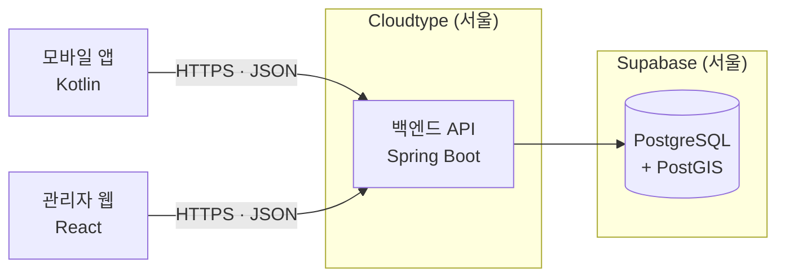

# 다시, 시흥 · 백엔드 연동 가이드

> 앱(Kotlin) · 관리자 웹(React) 담당자를 위한 문서입니다.
> 서버 주소, 연결 방법, API 확인 방법, 변경 사항을 주고받는 방법을 정리했습니다.   
> 작성자: 원종우     
> 작성일 2026-10-22

---

## 목차

1. [한눈에 보기](#1-한눈에-보기)
2. [서버 운영 정보](#2-서버-운영-정보)
3. [공통 규칙](#3-공통-규칙)
4. [앱(Kotlin) 연결하기](#4-앱kotlin-연결하기)
5. [관리자 웹(React) 연결하기](#5-관리자-웹react-연결하기)
6. [API 확인하는 방법](#6-api-확인하는-방법)
7. [API 변경 사항 주고받기](#7-api-변경-사항-주고받기)
8. [문제 해결](#8-문제-해결)
9. [기능별 API 목록](#9-기능별-api-목록)

---

## 1. 한눈에 보기

### 주소

| 용도 | 주소 |
| --- | --- |
| **API 기본 주소** | `https://port-0-dasi-siheung-backend-mvi7gzqc5a140e65.sel3.cloudtype.app` |
| Swagger UI (API 문서 · 직접 호출) | [/swagger-ui.html](https://port-0-dasi-siheung-backend-mvi7gzqc5a140e65.sel3.cloudtype.app/swagger-ui.html) |
| 연결 확인 | [/api/v1/system/ping](https://port-0-dasi-siheung-backend-mvi7gzqc5a140e65.sel3.cloudtype.app/api/v1/system/ping) |
| 서버 상태 | [/actuator/health](https://port-0-dasi-siheung-backend-mvi7gzqc5a140e65.sel3.cloudtype.app/actuator/health) |
| 실시간 명세 (JSON · YAML) | [/v3/api-docs](https://port-0-dasi-siheung-backend-mvi7gzqc5a140e65.sel3.cloudtype.app/v3/api-docs) · [/v3/api-docs.yaml](https://port-0-dasi-siheung-backend-mvi7gzqc5a140e65.sel3.cloudtype.app/v3/api-docs.yaml) |
| 테스트로 검증된 명세 | [/docs/openapi3.yaml](https://port-0-dasi-siheung-backend-mvi7gzqc5a140e65.sel3.cloudtype.app/docs/openapi3.yaml) |
| 백엔드 저장소 | `TUK-Mobile-Programming-1-2/dasi-siheung-backend` |

**브라우저로 [연결 확인](https://port-0-dasi-siheung-backend-mvi7gzqc5a140e65.sel3.cloudtype.app/api/v1/system/ping) 주소를 열어보세요.** 아래처럼 나오면 서버가 정상입니다.

```json
{ "success": true, "data": { "status": "OK", "serverTime": "2026-10-22T00:30:00.123+09:00" } }
```

### 구성



- 앱과 관리자 웹은 **백엔드 API만 호출합니다.** DB(Supabase)에 직접 접속하지 않습니다.
  Supabase의 자체 API 기능도 꺼져 있어서 Supabase 키는 필요 없습니다.
- 개발 서버를 따로 띄우지 않고 **위 운영 주소 하나로 개발·테스트합니다.** 백엔드를 로컬에서 실행할 필요가 없습니다.

---

## 2. 서버 운영 정보

| 상황 | 내용 | 대응 |
| --- | --- | --- |
| **하루 한 번 서버 중지** | Cloudtype 무료 플랜이라 매일 1회 서버가 멈춥니다 | 응답이 없으면 백엔드 담당에게 알려주세요. 다시 켜면 2~3분 뒤 정상 |
| **새 버전 배포 중** | 백엔드 `main` 브랜치에 변경이 들어가면 자동 재배포되며, 약 3분간 응답이 없습니다 | 배포 전후로 팀 채널에 공지합니다 |
| **첫 요청이 느림** | 서버가 막 켜진 직후에는 응답이 몇 초 걸릴 수 있습니다 | 요청 제한 시간(timeout)을 넉넉히 (아래 예시 60초) |

---

## 3. 공통 규칙

### 3-1. 요청

| 항목 | 규칙 |
| --- | --- |
| 프로토콜 | HTTPS |
| 경로 | 모든 API는 `/api/v1/...` 로 시작 |
| 본문 형식 | JSON (`Content-Type: application/json`), UTF-8 |
| 시각 | ISO-8601 문자열, 서울 시간 (`2026-10-22T00:30:00+09:00`) |
| 인증 | `Authorization: Bearer <액세스 토큰>` 헤더 (아래 3-4 참고) |

### 3-2. 응답 형식

모든 API가 같은 모양으로 응답합니다. **`success` 로 성공 여부를 먼저 확인하세요.**

**성공**

```json
{
  "success": true,
  "data": { "...": "API마다 다른 실제 데이터" }
}
```

**실패**

```json
{
  "success": false,
  "error": {
    "code": "INVALID_INPUT",
    "message": "요청 값이 올바르지 않습니다.",
    "fieldErrors": [
      { "field": "name", "reason": "공백일 수 없습니다" }
    ]
  }
}
```

- 값이 없는 항목은 **아예 빠집니다.** 성공이면 `error` 가 없고, 실패면 `data` 가 없습니다. 반환할 데이터가 없는 성공 응답은 `{ "success": true }` 만 옵니다.
- `fieldErrors` 는 입력값 검증에 실패했을 때만 옵니다.
- 앱·웹 모델에서는 `data`, `error`, `fieldErrors` 를 **없을 수 있는 값(nullable)** 으로 선언하세요.
- 나중에 응답에 항목이 **추가될 수 있습니다.** 모르는 항목은 무시하도록 설정해 두세요. (Gson은 기본으로 무시, kotlinx.serialization은 `ignoreUnknownKeys = true`)

### 3-3. 오류 코드

화면 분기는 **`error.code`** 로, 사용자에게 보여줄 문구는 **`error.message`** 를 쓰면 됩니다.

| `error.code` | HTTP 상태 | 언제 | 화면 처리 예시 |
| --- | --- | --- | --- |
| `INVALID_INPUT` | 400 | 필수값 누락, 형식 오류, 숫자 자리에 문자 등 | `fieldErrors` 로 해당 입력칸 아래에 사유 표시 |
| `UNAUTHORIZED` | 401 | 토큰 없이 로그인이 필요한 API 호출 | 로그인 화면으로 이동 |
| `FORBIDDEN` | 403 | 로그인했지만 역할 권한 없음 (예: 이용자가 관리자 기능 호출) | "권한이 없습니다" 안내 |
| `RESOURCE_NOT_FOUND` | 404 | 없는 주소 | "찾을 수 없습니다" 안내 |
| `METHOD_NOT_ALLOWED` | 405 | GET/POST 등을 잘못 씀 | 개발 중 실수 → 백엔드 담당에게 문의 |
| `UNSUPPORTED_MEDIA_TYPE` | 415 | JSON이 아닌 본문 전송 | `Content-Type: application/json` 확인 |
| `DATA_CONFLICT` | 409 | 같은 데이터를 동시에 수정함 | 새로고침 후 다시 시도 안내 |
| `INTERNAL_SERVER_ERROR` | 500 | 서버 오류 | "잠시 후 다시 시도" 안내 + 백엔드 담당에게 제보 |

<!-- ERROR_CODES_BY_FEATURE -->
**인증 · 회원**

| `error.code` | HTTP 상태 | 언제 | 화면 처리 예시 |
| --- | --- | --- | --- |
| `DUPLICATE_EMAIL` | 409 | 이미 가입된 이메일로 가입 | 이메일 입력칸에 "이미 가입된 이메일" |
| `ROLE_NOT_ALLOWED` | 400 | 가입 역할로 ADMIN 을 보냄 | 개발 중 실수 (가입은 USER / PROVIDER 만) |
| `INVALID_CREDENTIALS` | 401 | 이메일·비밀번호 불일치, 탈퇴 계정 | "이메일 또는 비밀번호를 확인하세요" |
| `INVALID_TOKEN` | 401 | 위조·손상된 액세스 토큰 | 저장된 토큰 삭제 후 로그인 화면 |
| `EXPIRED_TOKEN` | 401 | 액세스 토큰 만료 (30분) | **재발급 API 호출 후 원래 요청 재시도** |
| `INVALID_REFRESH_TOKEN` | 401 | 리프레시 토큰 만료·폐기·재사용 | 로그인 화면으로 이동 |
| `ACCOUNT_SUSPENDED` | 403 | 이용 정지된 계정으로 로그인 | `error.message` 그대로 표시 (해제 예정일 포함) |
| `MEMBER_NOT_FOUND` | 404 | 없는 회원 | "찾을 수 없습니다" 안내 |

### 3-4. 인증 (JWT)

| 토큰 | 유효 시간 | 쓰는 곳 |
| --- | --- | --- |
| 액세스 토큰 (JWT) | 30분 | 모든 요청의 `Authorization: Bearer {accessToken}` 헤더 |
| 리프레시 토큰 | 14일 | 액세스 토큰이 만료됐을 때 `POST /api/v1/auth/refresh` 로 새 토큰 받기 |

```
로그인 ─▶ accessToken + refreshToken 저장 (앱: EncryptedSharedPreferences / 웹: 메모리 + localStorage)
  │
  ├─ API 호출 ── 200 ─▶ 정상
  │      └──── 401 EXPIRED_TOKEN ─▶ /auth/refresh ─▶ 새 토큰 2개로 교체 저장 ─▶ 원래 요청 재시도
  │                                      └── 401 INVALID_REFRESH_TOKEN ─▶ 로그인 화면
  └─ 로그아웃 ─▶ /auth/logout (refreshToken 폐기) ─▶ 저장된 토큰 삭제
```

- **재발급하면 리프레시 토큰도 새 값으로 바뀝니다.** 이전 리프레시 토큰은 바로 폐기되므로 반드시 둘 다 교체 저장하세요.
- 여러 요청이 동시에 `EXPIRED_TOKEN` 을 받으면 재발급은 **한 번만** 호출하고 나머지는 그 결과를 기다리게 하세요. (같은 리프레시 토큰으로 두 번 재발급하면 두 번째는 실패)
- 역할은 **이용자(USER) / 공간 제공자(PROVIDER) / 관리자(ADMIN)** 입니다. 역할에 맞지 않는 API는 403 `FORBIDDEN` 입니다.
- 관리자는 가입할 수 없고 백엔드 담당이 DB에서 승격합니다. 승격 직후에는 **다시 로그인**해야 관리자 권한이 토큰에 반영됩니다.
- 로그인 없이 호출할 수 있는 API: 연결 확인(`/api/v1/system/**`), 회원가입·로그인·재발급·로그아웃(`/api/v1/auth/**`)

---

## 4. 앱(Kotlin) 연결하기

Retrofit + Gson 기준 예시입니다. 다른 라이브러리를 써도 [3. 공통 규칙](#3-공통-규칙)만 지키면 됩니다.

### 4-1. 준비

**`AndroidManifest.xml`** — 인터넷 권한

```xml
<uses-permission android:name="android.permission.INTERNET" />
```

**`app/build.gradle.kts`** — 의존성

```kotlin
dependencies {
    implementation("com.squareup.retrofit2:retrofit:2.11.0")
    implementation("com.squareup.retrofit2:converter-gson:2.11.0")
    implementation("com.squareup.okhttp3:logging-interceptor:4.12.0") // 개발 중 요청·응답 로그
}
```

### 4-2. 공통 응답 모델

```kotlin
data class ApiResult<T>(
    val success: Boolean,
    val data: T? = null,
    val error: ErrorResponse? = null,
)

data class ErrorResponse(
    val code: String,
    val message: String,
    val fieldErrors: List<FieldError>? = null,
)

data class FieldError(
    val field: String,
    val reason: String,
)
```

### 4-3. API 클라이언트

```kotlin
object ApiClient {

    // 끝의 / 를 빼면 Retrofit 이 오류를 냅니다
    private const val BASE_URL =
        "https://port-0-dasi-siheung-backend-mvi7gzqc5a140e65.sel3.cloudtype.app/"

    private val okHttpClient = OkHttpClient.Builder()
        .connectTimeout(30, TimeUnit.SECONDS)
        .readTimeout(60, TimeUnit.SECONDS)   // 서버가 막 켜진 직후를 고려
        .addInterceptor(HttpLoggingInterceptor().apply {
            level = HttpLoggingInterceptor.Level.BODY
        })
        .build()

    val retrofit: Retrofit = Retrofit.Builder()
        .baseUrl(BASE_URL)
        .client(okHttpClient)
        .addConverterFactory(GsonConverterFactory.create())
        .build()
}
```

> 앱을 출시용으로 만들 때는 로그 레벨을 `NONE` 으로 바꿔 주세요. (토큰이 로그에 남지 않도록)

### 4-4. API 정의와 호출 — 연결 확인 예시

```kotlin
data class PingResponse(
    val status: String,      // "OK"
    val serverTime: String,  // "2026-10-22T00:30:00+09:00"
)

interface SystemApi {
    @GET("api/v1/system/ping")
    suspend fun ping(): Response<ApiResult<PingResponse>>
}

val systemApi: SystemApi = ApiClient.retrofit.create(SystemApi::class.java)
```

실패 응답(4xx·5xx)은 Retrofit이 `body()` 대신 `errorBody()` 에 담습니다. 아래 함수 하나로 성공·실패·네트워크 오류를 모두 `ApiResult` 로 받을 수 있습니다.

```kotlin
private val gson = Gson()
private data class ErrorBody(val error: ErrorResponse?)

private val SERVER_UNAVAILABLE =
    ErrorResponse("SERVER_UNAVAILABLE", "서버가 응답하지 않습니다. 잠시 후 다시 시도해 주세요.")
private val NETWORK_ERROR =
    ErrorResponse("NETWORK_ERROR", "인터넷 연결을 확인해 주세요.")

suspend fun <T> apiCall(request: suspend () -> Response<ApiResult<T>>): ApiResult<T> =
    try {
        val response = request()
        response.body() ?: ApiResult(success = false, error = parseError(response))
    } catch (e: IOException) {
        ApiResult(success = false, error = NETWORK_ERROR)
    }

// 서버가 중지·배포 중이면 JSON 이 아닌 오류 페이지가 올 수 있어 파싱 실패도 처리한다
private fun parseError(response: Response<*>): ErrorResponse =
    runCatching {
        gson.fromJson(response.errorBody()?.charStream(), ErrorBody::class.java)?.error
    }.getOrNull() ?: SERVER_UNAVAILABLE
```

```kotlin
// ViewModel 등에서
viewModelScope.launch {
    val result = apiCall { systemApi.ping() }
    if (result.success) {
        val ping = result.data!!
        // 성공 처리
    } else {
        when (result.error?.code) {
            "UNAUTHORIZED" -> { /* 로그인 화면으로 */ }
            "NETWORK_ERROR", "SERVER_UNAVAILABLE" -> { /* 연결 상태 안내 + 다시 시도 버튼 */ }
            else -> { /* result.error?.message 표시 */ }
        }
    }
}
```

`NETWORK_ERROR`, `SERVER_UNAVAILABLE` 은 서버가 보내는 코드가 아니라 **앱에서 만든 코드**입니다.

---

## 5. 관리자 웹(React) 연결하기

### 5-1. 주소 설정

**`.env.development`** (Vite 기준)

```bash
VITE_API_BASE_URL=https://port-0-dasi-siheung-backend-mvi7gzqc5a140e65.sel3.cloudtype.app
```

### 5-2. 공통 요청 함수

```js
// src/api/client.js
const BASE_URL = import.meta.env.VITE_API_BASE_URL;

export class ApiError extends Error {
  constructor(error, status) {
    super(error.message);
    this.code = error.code;
    this.fieldErrors = error.fieldErrors ?? [];
    this.status = status;
  }
}

const NETWORK_ERROR = { code: 'NETWORK_ERROR', message: '인터넷 연결을 확인해 주세요.' };
const SERVER_UNAVAILABLE = {
  code: 'SERVER_UNAVAILABLE',
  message: '서버가 응답하지 않습니다. 잠시 후 다시 시도해 주세요.',
};

export async function api(path, { method = 'GET', body, token } = {}) {
  let response;
  try {
    response = await fetch(`${BASE_URL}${path}`, {
      method,
      headers: {
        'Content-Type': 'application/json',
        ...(token && { Authorization: `Bearer ${token}` }),
      },
      body: body ? JSON.stringify(body) : undefined,
    });
  } catch {
    throw new ApiError(NETWORK_ERROR, 0); // 인터넷 끊김, CORS 차단 등
  }

  // 서버가 중지·배포 중이면 JSON 이 아닌 오류 페이지가 올 수 있다
  const result = await response.json().catch(() => null);
  if (!result) {
    throw new ApiError(SERVER_UNAVAILABLE, response.status);
  }
  if (!result.success) {
    throw new ApiError(result.error, response.status);
  }
  return result.data;
}
```

```js
// 사용 예시
import { api, ApiError } from './api/client';

try {
  const ping = await api('/api/v1/system/ping');
  console.log(ping.status); // "OK"
} catch (e) {
  if (e instanceof ApiError && e.code === 'UNAUTHORIZED') {
    // 로그인 페이지로 이동
  }
}
```

### 5-3. CORS (브라우저 접근 허용)

브라우저는 허용된 주소에서만 다른 서버의 API를 호출할 수 있습니다. 현재 허용된 주소는 아래와 같습니다.

| 허용 주소 | 용도 |
| --- | --- |
| `http://localhost:5173` | Vite 개발 서버 기본 포트 |
| `http://localhost:3000` | CRA · Next.js 개발 서버 기본 포트 |

- 다른 포트를 쓰거나 **관리자 웹을 배포해서 주소가 생기면 백엔드 담당에게 알려주세요.** 허용 목록에 추가합니다.
- 브라우저 콘솔에 `CORS policy` 오류가 보이면 거의 이 문제입니다.
- 허용되는 메서드는 `GET POST PUT PATCH DELETE`, 헤더 제한은 없습니다. 쿠키는 쓰지 않습니다. 인증은 헤더의 토큰으로 합니다.

---

## 6. API 확인하는 방법

### 6-1. Swagger UI — 가장 먼저 보는 곳

[Swagger UI](https://port-0-dasi-siheung-backend-mvi7gzqc5a140e65.sel3.cloudtype.app/swagger-ui.html) 에서 모든 API의 주소, 요청 값, 응답 모양을 보고 **바로 호출해 볼 수 있습니다.**

1. 오른쪽 위 **명세 선택 상자**에서 보고 싶은 명세를 고릅니다. (아래 6-2 참고)
2. API를 펼치고 **Try it out** → 값 입력 → **Execute**
3. 아래에 실제 응답과 상태 코드가 나옵니다.
4. 로그인이 필요한 API는 오른쪽 위 **Authorize** 에 토큰을 넣고 호출합니다. (로그인 기능 개발 후)

### 6-2. 명세가 두 가지인 이유

| | 실시간 명세 | 테스트로 검증된 명세 |
| --- | --- | --- |
| 주소 | `/v3/api-docs` | `/docs/openapi3.yaml` |
| 만들어지는 방식 | 서버 코드에서 자동 생성 | 백엔드 테스트가 **실제 응답을 검사**한 뒤 생성 |
| 들어 있는 API | 개발된 모든 API | 테스트까지 끝난 API |
| 믿을 수 있는 정도 | 코드와 같음 | 실제 응답과 같다는 것이 보장됨 |
| 추천 용도 | 전체 목록 보기, 코드 자동 생성 | 응답 예시 확인, 화면 개발 기준 |

두 명세에 같은 API가 있으면 내용도 같아야 합니다. 다르면 백엔드 버그이니 알려주세요.

### 6-3. 명세 파일(openapi3.yaml) 활용

명세 파일은 OpenAPI 3 표준 형식이라 여러 도구에서 그대로 쓸 수 있습니다.

| 하고 싶은 것 | 방법 |
| --- | --- |
| **Postman 으로 테스트** | Postman → Import → Link 에 `.../v3/api-docs` 주소 붙여넣기 → 모든 API가 요청 목록으로 생성 |
| **React 타입 자동 생성 (TypeScript)** | `npx openapi-typescript https://port-0-dasi-siheung-backend-mvi7gzqc5a140e65.sel3.cloudtype.app/v3/api-docs -o src/api/schema.d.ts` |
| **Kotlin 모델 자동 생성** | [OpenAPI Generator](https://openapi-generator.tech/) 의 `kotlin` 생성기에 `.../v3/api-docs` 지정 (선택 사항, 직접 data class 를 써도 충분) |
| **변경 내용 확인** | 백엔드 저장소의 `src/main/resources/static/docs/openapi3.yaml` 변경 이력 (PR 화면) |

### 6-4. 요청 예시 파일 (`.http`)

백엔드 저장소의 `http/` 폴더에 API별 **요청 예시와 기대 응답**이 있습니다.

- IntelliJ / Android Studio 에서 파일을 열고 실행 환경을 `prod` 로 고르면 운영 서버에 바로 요청할 수 있습니다.
- 각 요청 위 주석에 **기대 응답**이 적혀 있어 응답 모양을 확인하기 좋습니다.
- 같은 파일을 백엔드 CI 가 매번 실행해서, 적힌 기대값이 실제와 다르면 배포되지 않습니다.

---

## 7. API 변경 사항 주고받기

### 7-1. 백엔드 → 프론트 (새 API · 변경 공지)

새 API가 배포되면 팀 채널에 아래 형식으로 공지합니다.

```
[API 추가] 공간 목록 조회
- 경로: GET /api/v1/spaces
- 인증: 필요 없음
- Swagger: (Swagger UI 에서 'Space' 항목)
- 변경 내역: (백엔드 PR 링크)
- 배포: 완료 (2026-10-29 21:00)
```

- 공지가 올라온 시점에는 **Swagger, 명세 파일, `.http` 예시가 모두 갱신된 상태**입니다.
- PR 링크를 열면 `openapi3.yaml` 에서 무엇이 추가·변경됐는지 줄 단위로 볼 수 있습니다.

### 7-2. 프론트 → 백엔드 (API 요청)

필요한 API가 있으면 아래 내용을 채워서 백엔드 담당에게 보내주세요. (GitHub 이슈 또는 팀 채널)

```
[API 요청] 화면 이름
- 화면: 어떤 화면에서 쓰나요? (Figma 링크 있으면 첨부)
- 필요한 데이터: 화면에 보여줄 항목
- 사용자 동작: 버튼을 누르면 무엇이 저장·변경되나요?
- 필터·정렬·페이지: 필요한 경우
- 응답 예시(선택): 이런 모양이면 좋겠다
- 필요한 날짜:
```

### 7-3. 호환성 약속

- 응답에 **항목을 추가**하는 것은 공지 없이 할 수 있습니다. 모르는 항목은 무시하도록 설정해 주세요. ([3-2](#3-2-응답-형식) 참고)
- 항목 이름 변경·삭제, 타입 변경처럼 **앱·웹이 깨지는 변경은 미리 공지**하고, 함께 일정을 맞춘 뒤 반영합니다.
- 큰 구조 변경이 필요하면 기존 `/api/v1` 은 유지하고 새 경로로 추가합니다.

---

## 8. 문제 해결

| 증상 | 원인 | 해결 |
| --- | --- | --- |
| 아무 응답이 없음 / 시간 초과 | 서버 중지 또는 배포 중 | [연결 확인](https://port-0-dasi-siheung-backend-mvi7gzqc5a140e65.sel3.cloudtype.app/api/v1/system/ping) 주소로 확인 → 안 열리면 백엔드 담당에게 연락 |
| 앱에서 `UnknownHostException` | 기기 인터넷 연결 없음, 또는 `INTERNET` 권한 누락 | 기기 네트워크와 [4-1](#4-1-준비) 권한 확인 |
| 브라우저 콘솔에 `CORS policy` | 허용되지 않은 주소에서 호출 | [5-3](#5-3-cors-브라우저-접근-허용) — 쓰는 주소를 백엔드 담당에게 전달 |
| 401 `UNAUTHORIZED` | 토큰 없음·만료, 또는 아직 인증이 필요한 API | `Authorization` 헤더 확인, 다시 로그인 |
| 400 `INVALID_INPUT` | 요청 값 오류 | `fieldErrors` 의 `field`·`reason` 확인, Swagger 의 요청 형식과 비교 |
| 415 `UNSUPPORTED_MEDIA_TYPE` | `Content-Type` 누락 | `Content-Type: application/json` 헤더 추가 |
| 한글이 깨짐 | 응답을 UTF-8이 아닌 방식으로 읽음 | 응답은 항상 UTF-8 입니다. 문자열 변환 설정 확인 |
| 시간이 9시간 차이 남 | 서버 시각을 UTC로 해석 | 시각 문자열 끝의 `+09:00` 을 포함해 해석 (`OffsetDateTime` · `new Date()` 는 자동 처리) |
| 500 `INTERNAL_SERVER_ERROR` | 백엔드 오류 | **요청 주소, 보낸 값, 시각**을 함께 백엔드 담당에게 전달 |

---

**문의 · 요청 · 장애 제보: 원종우(갠톡 주세요)**

---

## 9. 기능별 API 목록

요청·응답 필드는 Swagger UI 에서, 호출 순서와 기대값은 `http/*.http` 에서 확인하세요.
인증 열: **공개** = 토큰 없이 호출 / **로그인** = 역할 무관 / **USER·PROVIDER·ADMIN** = 해당 역할만

<!-- API_LIST -->
### 인증 (`http/auth.http`)

| 메서드 | 경로 | 인증 | 설명 |
| --- | --- | --- | --- |
| POST | `/api/v1/auth/signup` | 공개 | 회원가입 (USER / PROVIDER) |
| POST | `/api/v1/auth/login` | 공개 | 로그인 → 액세스·리프레시 토큰 |
| POST | `/api/v1/auth/refresh` | 공개 | 토큰 재발급 (리프레시 토큰 교체) |
| POST | `/api/v1/auth/logout` | 공개 | 로그아웃 (리프레시 토큰 폐기) |

