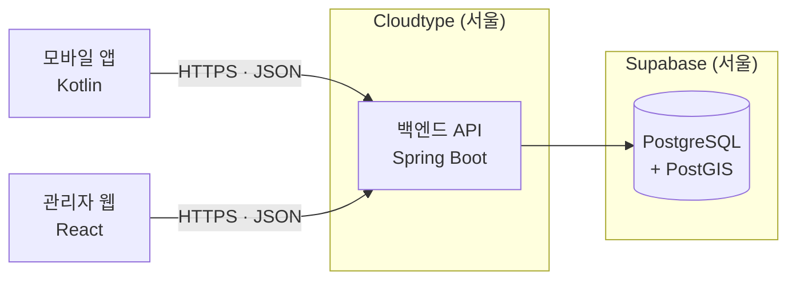

# 다시, 시흥 · 백엔드 연동 가이드

> 앱(Kotlin) · 관리자 웹(React) 담당자를 위한 문서입니다.
> 서버 주소, 연결 방법, API 확인 방법, 변경 사항을 주고받는 방법을 정리했습니다.   
> 작성자: 원종우     
> 작성일 2026-10-22

---

## 목차

1. [한눈에 보기](#1-한눈에-보기)
2. [서버 운영 정보 · 테스트 계정](#2-서버-운영-정보)
3. [공통 규칙](#3-공통-규칙)
4. [앱(Kotlin) 연결하기](#4-앱kotlin-연결하기)
5. [관리자 웹(React) 연결하기](#5-관리자-웹react-연결하기)
6. [API 확인하는 방법](#6-api-확인하는-방법)
7. [API 변경 사항 주고받기](#7-api-변경-사항-주고받기)
8. [문제 해결](#8-문제-해결)
9. [기능별 API 목록](#9-기능별-api-목록)

---

## 1. 한눈에 보기

### 주소

| 용도 | 주소 |
| --- | --- |
| **API 기본 주소** | `https://port-0-dasi-siheung-backend-mvi7gzqc5a140e65.sel3.cloudtype.app` |
| Swagger UI (API 문서 · 직접 호출) | [/swagger-ui.html](https://port-0-dasi-siheung-backend-mvi7gzqc5a140e65.sel3.cloudtype.app/swagger-ui.html) |
| 연결 확인 | [/api/v1/system/ping](https://port-0-dasi-siheung-backend-mvi7gzqc5a140e65.sel3.cloudtype.app/api/v1/system/ping) |
| 서버 상태 | [/actuator/health](https://port-0-dasi-siheung-backend-mvi7gzqc5a140e65.sel3.cloudtype.app/actuator/health) |
| 실시간 명세 (JSON · YAML) | [/v3/api-docs](https://port-0-dasi-siheung-backend-mvi7gzqc5a140e65.sel3.cloudtype.app/v3/api-docs) · [/v3/api-docs.yaml](https://port-0-dasi-siheung-backend-mvi7gzqc5a140e65.sel3.cloudtype.app/v3/api-docs.yaml) |
| 테스트로 검증된 명세 | [/docs/openapi3.yaml](https://port-0-dasi-siheung-backend-mvi7gzqc5a140e65.sel3.cloudtype.app/docs/openapi3.yaml) |
| 백엔드 저장소 | `TUK-Mobile-Programming-1-2/dasi-siheung-backend` |

**브라우저로 [연결 확인](https://port-0-dasi-siheung-backend-mvi7gzqc5a140e65.sel3.cloudtype.app/api/v1/system/ping) 주소를 열어보세요.** 아래처럼 나오면 서버가 정상입니다.

```json
{ "success": true, "data": { "status": "OK", "serverTime": "2026-10-22T00:30:00.123+09:00" } }
```

### 구성



- 앱과 관리자 웹은 **백엔드 API만 호출합니다.** DB(Supabase)에 직접 접속하지 않습니다.
  Supabase의 자체 API 기능도 꺼져 있어서 Supabase 키는 필요 없습니다.
- 개발 서버를 따로 띄우지 않고 **위 운영 주소 하나로 개발·테스트합니다.** 백엔드를 로컬에서 실행할 필요가 없습니다.

---

## 2. 서버 운영 정보

| 상황 | 내용 | 대응 |
| --- | --- | --- |
| **하루 한 번 서버 중지** | Cloudtype 무료 플랜이라 매일 1회 서버가 멈춥니다 | 응답이 없으면 백엔드 담당에게 알려주세요. 다시 켜면 2~3분 뒤 정상 |
| **새 버전 배포 중** | 백엔드 `main` 브랜치에 변경이 들어가면 자동 재배포되며, 약 3분간 응답이 없습니다 | 배포 전후로 팀 채널에 공지합니다 |
| **첫 요청이 느림** | 서버가 막 켜진 직후에는 응답이 몇 초 걸릴 수 있습니다 | 요청 제한 시간(timeout)을 넉넉히 (아래 예시 60초) |

### 테스트 계정 · 데이터

배포 서버에는 테스트용 시연 데이터가 들어 있습니다. 회원가입 없이 아래 계정으로 바로 로그인해 테스트하세요.
**비밀번호는 모두 `demo1234!`** 입니다.

| 이메일 | 이름 | 역할 | 준비된 상황 |
| --- | --- | --- | --- |
| `provider1@demo.dasisiheung.com` | 김정왕 | 공간 제공자 | 공개 공간 2곳(정왕역 코너 상가 · 대학가 쇼룸), 확정 예약 1건, 답글 대기 후기 1개 |
| `provider2@demo.dasisiheung.com` | 박배곧 | 공간 제공자 | 공개 공간 2곳(카페거리 갤러리 · 공원 앞 상가), **가격 협의 대기** 신청 1건, 검토 중 신청 1건, 답글 대기 후기 1개 |
| `provider3@demo.dasisiheung.com` | 이거북 | 공간 제공자 | 공개 공간 1곳(마리나), **검수 대기** 공간 1곳, 검토 중 신청 1건, 이용자와 1:1 대화 |
| `user1@demo.dasisiheung.com` | 최팝업 | 이용자 | 찜 2곳, 가격 제안을 보낸 신청, 지난 이용 후기 2개, 커뮤니티 모집 글 |
| `user2@demo.dasisiheung.com` | 정전시 | 이용자 | 확정 예약 1건(대학가 쇼룸), 지난 이용 후기 1개 |
| `user3@demo.dasisiheung.com` | 한클래스 | 이용자 | 검토 중 신청 1건(공원 앞 상가), 지난 이용 후기 1개 |
| `user4@demo.dasisiheung.com` | 오체험 | 이용자 | 검토 중 신청 1건(마리나), 제공자와 1:1 대화, 지난 이용 후기 1개 |

- 공개 공간의 사용 가능 날짜는 데이터를 만든 다음 날부터 **180일**입니다. 이 안에서 신청을 테스트하세요.
- 모두가 같은 계정을 쓰므로 **비밀번호 변경 · 탈퇴는 하지 마세요.** 그런 테스트는 직접 가입한 계정으로 합니다.
- **관리자 계정은 없습니다.** 관리자 웹은 테스트용으로 가입한 계정을 백엔드 담당에게 알려주면 관리자로 바꿔 드립니다.
- 데이터가 꼬였거나 처음 상태로 되돌리고 싶으면 백엔드 담당에게 알려주세요. 시연 데이터를 지우고 다시 만듭니다.

---

## 3. 공통 규칙

### 3-1. 요청

| 항목 | 규칙 |
| --- | --- |
| 프로토콜 | HTTPS |
| 경로 | 모든 API는 `/api/v1/...` 로 시작 |
| 본문 형식 | JSON (`Content-Type: application/json`), UTF-8 |
| 시각 | ISO-8601 문자열, 서울 시간 (`2026-10-22T00:30:00+09:00`) |
| 인증 | `Authorization: Bearer <액세스 토큰>` 헤더 (아래 3-4 참고) |

### 3-2. 응답 형식

모든 API가 같은 모양으로 응답합니다. **`success` 로 성공 여부를 먼저 확인하세요.**

**성공**

```json
{
  "success": true,
  "data": { "...": "API마다 다른 실제 데이터" }
}
```

**실패**

```json
{
  "success": false,
  "error": {
    "code": "INVALID_INPUT",
    "message": "요청 값이 올바르지 않습니다.",
    "fieldErrors": [
      { "field": "name", "reason": "공백일 수 없습니다" }
    ]
  }
}
```

- 값이 없는 항목은 **아예 빠집니다.** 성공이면 `error` 가 없고, 실패면 `data` 가 없습니다. 반환할 데이터가 없는 성공 응답은 `{ "success": true }` 만 옵니다.
- `fieldErrors` 는 입력값 검증에 실패했을 때만 옵니다.
- 앱·웹 모델에서는 `data`, `error`, `fieldErrors` 를 **없을 수 있는 값(nullable)** 으로 선언하세요.
- 나중에 응답에 항목이 **추가될 수 있습니다.** 모르는 항목은 무시하도록 설정해 두세요. (Gson은 기본으로 무시, kotlinx.serialization은 `ignoreUnknownKeys = true`)

### 3-3. 오류 코드

화면 분기는 **`error.code`** 로, 사용자에게 보여줄 문구는 **`error.message`** 를 쓰면 됩니다.

| `error.code` | HTTP 상태 | 언제 | 화면 처리 예시 |
| --- | --- | --- | --- |
| `INVALID_INPUT` | 400 | 필수값 누락, 형식 오류, 숫자 자리에 문자 등 | `fieldErrors` 로 해당 입력칸 아래에 사유 표시 |
| `UNAUTHORIZED` | 401 | 토큰 없이 로그인이 필요한 API 호출 | 로그인 화면으로 이동 |
| `FORBIDDEN` | 403 | 로그인했지만 역할 권한 없음 (예: 이용자가 관리자 기능 호출) | "권한이 없습니다" 안내 |
| `RESOURCE_NOT_FOUND` | 404 | 없는 주소 | "찾을 수 없습니다" 안내 |
| `METHOD_NOT_ALLOWED` | 405 | GET/POST 등을 잘못 씀 | 개발 중 실수 → 백엔드 담당에게 문의 |
| `UNSUPPORTED_MEDIA_TYPE` | 415 | JSON이 아닌 본문 전송 | `Content-Type: application/json` 확인 |
| `DATA_CONFLICT` | 409 | 같은 데이터를 동시에 수정함 | 새로고침 후 다시 시도 안내 |
| `INTERNAL_SERVER_ERROR` | 500 | 서버 오류 | "잠시 후 다시 시도" 안내 + 백엔드 담당에게 제보 |

<!-- ERROR_CODES_BY_FEATURE -->
**인증 · 회원**

| `error.code` | HTTP 상태 | 언제 | 화면 처리 예시 |
| --- | --- | --- | --- |
| `DUPLICATE_EMAIL` | 409 | 이미 가입된 이메일로 가입 | 이메일 입력칸에 "이미 가입된 이메일" |
| `ROLE_NOT_ALLOWED` | 400 | 가입 역할로 ADMIN 을 보냄 | 개발 중 실수 (가입은 USER / PROVIDER 만) |
| `INVALID_CREDENTIALS` | 401 | 이메일·비밀번호 불일치, 탈퇴 계정 | "이메일 또는 비밀번호를 확인하세요" |
| `INVALID_TOKEN` | 401 | 위조·손상된 액세스 토큰 | 저장된 토큰 삭제 후 로그인 화면 |
| `EXPIRED_TOKEN` | 401 | 액세스 토큰 만료 (30분) | **재발급 API 호출 후 원래 요청 재시도** |
| `INVALID_REFRESH_TOKEN` | 401 | 리프레시 토큰 만료·폐기·재사용 | 로그인 화면으로 이동 |
| `ACCOUNT_SUSPENDED` | 403 | 이용 정지된 계정으로 로그인 | `error.message` 그대로 표시 (해제 예정일 포함) |
| `MEMBER_NOT_FOUND` | 404 | 없는 회원 | "찾을 수 없습니다" 안내 |
| `PASSWORD_MISMATCH` | 400 | 비밀번호 변경·탈퇴 시 현재 비밀번호 불일치 | 비밀번호 입력칸에 사유 표시 |
| `SAME_AS_CURRENT_PASSWORD` | 400 | 새 비밀번호가 현재와 같음 | "다른 비밀번호를 입력하세요" |

**파일**

| `error.code` | HTTP 상태 | 언제 | 화면 처리 예시 |
| --- | --- | --- | --- |
| `FILE_REQUIRED` | 400 | 파일 파트가 없거나 빈 파일 | "파일을 선택해 주세요" |
| `FILE_TOO_LARGE` | 413 | 파일당 제한(사진 10MB·증빙 20MB) 또는 요청 전체 100MB 초과 | `error.message` 그대로 표시 |
| `UNSUPPORTED_FILE_TYPE` | 400 | 허용하지 않는 형식, 확장자만 바꾼 파일 | 허용 형식 안내 |
| `STORAGE_UNAVAILABLE` | 503 | 파일 저장소 장애 | "잠시 후 다시 시도" |

**공간**

| `error.code` | HTTP 상태 | 언제 | 화면 처리 예시 |
| --- | --- | --- | --- |
| `SPACE_NOT_FOUND` | 404 | 없는 공간, 공개되지 않은 공간 | "찾을 수 없습니다" 안내 후 목록으로 |
| `SPACE_OUT_OF_SERVICE_AREA` | 400 | 좌표가 정왕동·거북섬·배곧 밖 | "서비스 지역의 공간만 등록할 수 있습니다" |
| `INVALID_AVAILABLE_DATE` | 400 | 사용 가능 날짜가 오늘 이전 또는 1년 뒤 이후 | 캘린더 선택 범위를 오늘~1년으로 제한 |
| `NOT_SPACE_OWNER` | 403 | 다른 제공자의 공간을 관리하려 함 | "본인 공간만 관리할 수 있습니다" |
| `SPACE_NOT_EDITABLE` | 409 | 관리자가 숨긴 공간을 수정하려 함 | 관리자 문의 안내 |
| `SPACE_PHOTO_LIMIT_EXCEEDED` | 400 | 사진이 10장을 넘음 | 남은 장수 안내 (`error.message`) |
| `SPACE_PHOTO_NOT_FOUND` | 404 | 없는 사진 ID | 목록 새로고침 |
| `INVALID_PHOTO_ORDER` | 400 | 순서 변경에 모든 사진 ID 를 한 번씩 보내지 않음 | 개발 중 실수 |
| `SPACE_PROOF_LIMIT_EXCEEDED` | 400 | 증빙이 5개를 넘음 | 기존 증빙 삭제 후 다시 시도 |
| `SPACE_PROOF_NOT_FOUND` | 404 | 없는 증빙 ID | 목록 새로고침 |
| `INVALID_SPACE_STATUS` | 409 | 지금 상태에서 할 수 없는 작업 (예: 검수 대기 중 일시 중단) | `error.message` 그대로 표시 |

**관리자 검수**

| `error.code` | HTTP 상태 | 언제 | 화면 처리 예시 |
| --- | --- | --- | --- |
| `SPACE_PROOF_REQUIRED` | 400 | 증빙이 없는 공간을 공개 승인 | 공개 보류로 처리하도록 안내 |
| `REVIEW_CHECKLIST_INCOMPLETE` | 400 | 5개 검수 항목을 모두 확인하지 않고 승인 | 체크하지 않은 항목 강조 |
| `REVIEW_REASON_REQUIRED` | 400 | 사유 없이 수정 요청·공개 보류 | 사유 입력칸 강조 |

**공간 둘러보기**

| `error.code` | HTTP 상태 | 언제 | 화면 처리 예시 |
| --- | --- | --- | --- |
| `INVALID_SEARCH_PERIOD` | 400 | 검색 기간이 오늘 이전이거나 90일을 넘음 | 날짜 선택기를 오늘~90일로 제한 |

**공간 이용 신청**

| `error.code` | HTTP 상태 | 언제 | 화면 처리 예시 |
| --- | --- | --- | --- |
| `APPLICATION_NOT_FOUND` | 404 | 없는 신청 | 목록으로 돌아가기 |
| `NOT_APPLICATION_PARTICIPANT` | 403 | 신청자도 공간 제공자도 아님 | 접근 불가 안내 |
| `ACTIVITY_NOT_ALLOWED` | 400 | 공간이 허용하지 않는 활동으로 신청 | 허용 활동만 선택지로 보여주기 |
| `INVALID_APPLICATION_PERIOD` | 400 | 지난 날짜 시작 · 30일 초과 | 날짜 선택기를 오늘~30일로 제한 |
| `PERIOD_NOT_AVAILABLE` | 409 | 기간 중 사용 가능 날짜가 아닌 날이 있음 | 캘린더 다시 불러오기 |
| `DUPLICATE_APPLICATION` | 409 | 같은 공간 · 겹치는 기간에 검토 중인 내 신청이 있음 | 기존 신청으로 이동 |
| `INVALID_APPLICATION_STATUS` | 409 | 이미 끝난 신청에 대한 작업 | 상세 새로고침 |
| `APPLICATION_NOT_CANCELLABLE` | 409 | 이용 시작일부터 확정 예약 취소 | 제공자와 1:1 소통 안내 |
| `PERIOD_ALREADY_BOOKED` | 409 | 같은 기간에 확정된 예약이 있음 (동시 승인 포함) | 캘린더 다시 불러오기 |
| `PRICE_NEGOTIATION_IN_PROGRESS` | 409 | 가격 제안이 답을 기다리는 중에 승인 | 협의 마무리 안내 |
| `ACTIVITY_PHOTO_NOT_ALLOWED` | 409 | 확정 예약이 아니거나 시점별 기간 밖에 활동 사진을 올림 | 시점 버튼을 기간에 맞춰 활성화 |
| `ACTIVITY_PHOTO_LIMIT_EXCEEDED` | 400 | 시점별 10장 초과 | 남은 장수 표시 |
| `ACTIVITY_PHOTO_NOT_FOUND` | 404 | 없는 활동 사진 | 목록 새로고침 |
| `NOT_PHOTO_UPLOADER` | 403 | 남이 올린 사진을 지움 | 삭제 버튼 숨기기 |

**가격 협의**

| `error.code` | HTTP 상태 | 언제 | 화면 처리 예시 |
| --- | --- | --- | --- |
| `INVALID_OFFER_PRICE` | 400 | 제안 금액이 1원 미만이거나 정가 합계 초과 | 입력 범위 안내 |
| `OFFER_NOT_ALLOWED` | 409 | 보낸 제안에 상대가 아직 답하지 않음 | 제안 버튼 비활성화 |
| `NO_PENDING_OFFER` | 409 | 내가 답할 제안이 없는데 수락 | 상세 새로고침 |

**이용 후기**

| `error.code` | HTTP 상태 | 언제 | 화면 처리 예시 |
| --- | --- | --- | --- |
| `REVIEW_NOT_ALLOWED` | 409 | 확정 예약이 아니거나 아직 이용이 끝나지 않음 | 이용 종료 다음 날부터 버튼 활성화 |
| `DUPLICATE_REVIEW` | 409 | 같은 예약에 후기를 또 씀 | 내 후기 수정으로 이동 |
| `REVIEW_NOT_FOUND` | 404 | 없는 후기 | 목록 새로고침 |
| `NOT_REVIEW_OWNER` | 403 | 남의 후기를 고치거나 지움 | 버튼 숨기기 |

**커뮤니티**

| `error.code` | HTTP 상태 | 언제 | 화면 처리 예시 |
| --- | --- | --- | --- |
| `POST_NOT_FOUND` | 404 | 없거나 숨김(신고 처리)된 글 | 목록으로 돌아가기 |
| `COMMENT_NOT_FOUND` | 404 | 없는 댓글 | 댓글 새로고침 |
| `NOT_POST_AUTHOR` | 403 | 남의 글을 고치거나 지움 | 수정 · 삭제 버튼은 mine 일 때만 |
| `NOT_COMMENT_AUTHOR` | 403 | 남의 댓글을 지움 | 삭제 버튼 숨기기 |
| `NOTICE_ADMIN_ONLY` | 403 | 관리자가 아닌데 공지 작성 | 분류 선택지에서 공지 빼기 |

**1:1 소통**

| `error.code` | HTTP 상태 | 언제 | 화면 처리 예시 |
| --- | --- | --- | --- |
| `CONVERSATION_NOT_FOUND` | 404 | 없는 대화 | 대화 목록으로 |
| `NOT_CONVERSATION_MEMBER` | 403 | 참여하지 않은 대화를 조회 · 전송 | 접근 불가 안내 |

**신고 · 제재**

| `error.code` | HTTP 상태 | 언제 | 화면 처리 예시 |
| --- | --- | --- | --- |
| `REPORT_NOT_FOUND` | 404 | 없는 신고 | 목록 새로고침 |
| `REPORT_TARGET_NOT_FOUND` | 404 | 신고 대상이 없음 | 이미 지워진 대상 안내 |
| `DUPLICATE_REPORT` | 409 | 처리 대기 중인 같은 신고가 있음 | 이미 신고했다고 안내 |
| `CANNOT_REPORT_SELF` | 400 | 자기 자신 · 자기 글 신고 | 신고 버튼 숨기기 |
| `REPORT_PHOTO_LIMIT_EXCEEDED` | 400 | 신고 사진 5장 초과 | 사진 선택을 5장으로 제한 |
| `REPORT_ALREADY_RESOLVED` | 409 | 이미 처리된 신고를 다시 처리 | 목록 새로고침 |
| `INVALID_REPORT_ACTION` | 400 | 회원 신고를 숨김 처리 | 정지 · 기각만 보여주기 |
| `CANNOT_SUSPEND_MEMBER` | 409 | 관리자 · 탈퇴 회원 정지 | 버튼 숨기기 |

### 3-3-1. 목록 응답 (페이지)

목록 API 는 `page`(0부터), `size`(기본 20, 최대 100) 쿼리 파라미터를 받고 아래 형식으로 응답합니다.

```jsonc
{
  "success": true,
  "data": {
    "content": [ { ... }, { ... } ],   // 현재 페이지 항목
    "page": 0,                         // 현재 페이지 (0부터)
    "size": 20,
    "totalElements": 35,
    "totalPages": 2,
    "hasNext": true                    // 무한 스크롤: false 가 될 때까지 page + 1 로 호출
  }
}
```

### 3-3-2. 선택지 (코드 · 이름)

지역·허용 활동·시설 같은 선택 목록은 **`GET /api/v1/options`** 로 받습니다. 요청에는 `code`, 화면에는 `label` 을 씁니다.
코드는 바뀌지 않고 이름만 바뀔 수 있으므로 **화면 문구를 앱에 하드코딩하지 마세요.**

### 3-3-3. 파일 업로드

- 파일은 **`multipart/form-data`** 로 보냅니다. 파트 이름은 API 마다 다르니 Swagger 를 확인하세요. (보통 `files` 또는 `file`, 신고 사진은 `photos`)
- 서버가 **파일 내용으로 형식을 판별**합니다. 확장자만 바꾼 파일은 400 `UNSUPPORTED_FILE_TYPE` 입니다.

| 종류 | 형식 | 파일당 최대 | 응답 주소 |
| --- | --- | --- | --- |
| 공간 사진 | JPG · PNG · WEBP | 10MB | 고정 주소 (그대로 `` / Coil 에 사용) |
| 권한 증빙 | PDF · JPG · PNG | 20MB | **10분짜리 임시 주소** — 만료되면 목록을 다시 조회 |
| 활동 전후 사진 | JPG · PNG · WEBP | 10MB | 10분짜리 임시 주소 |
| 신고 증거 사진 | JPG · PNG · WEBP | 10MB (최대 5장) | 10분짜리 임시 주소 — **관리자만** 열람 |

- 사진은 앱에서 **긴 변 2000px 이하로 줄여서** 올리면 업로드가 빠르고 용량 초과를 피할 수 있습니다.
- 임시 주소는 저장하지 말고 화면을 열 때마다 받은 값을 씁니다.

**텍스트 + 파일을 함께 보내는 예 — 신고하기** (`POST /api/v1/reports`)

텍스트 값도 각각 하나의 파트로 보냅니다. 사진이 없으면 `photos` 파트를 빼면 됩니다.

```kotlin
interface ReportApi {
    @Multipart
    @POST("api/v1/reports")
    suspend fun report(
        @Part("targetType") targetType: RequestBody,      // SPACE | POST | COMMENT | MEMBER
        @Part("targetId") targetId: RequestBody,
        @Part("reason") reason: RequestBody,              // 선택지 reportReasons
        @Part("detail") detail: RequestBody?,             // 선택
        @Part photos: List<MultipartBody.Part>,           // 선택, 최대 5장 (없으면 emptyList())
    ): Response<ApiResult<ReportResponse>>
}

fun String.toPart() = toRequestBody("text/plain".toMediaType())
fun File.toPhotoPart() = MultipartBody.Part.createFormData("photos", name, asRequestBody("image/jpeg".toMediaType()))
```

### 3-3-4. 주소 · 좌표 · 지역

- 공간 등록 화면에서 **앱의 지도 SDK 로 주소를 좌표(위도·경도)로 변환**해 `address` 와 함께 보냅니다.
- 지역(정왕동·거북섬·배곧)은 **서버가 좌표로 판정**합니다. 서비스 지역 밖이면 400 `SPACE_OUT_OF_SERVICE_AREA` 입니다.
- 날짜는 `yyyy-MM-dd`, 시각은 `yyyy-MM-ddTHH:mm:ss` (한국 시간, 시간대 표기 없음) 입니다.

### 3-3-5. 공간 공개 상태

```
등록 ─▶ PENDING_REVIEW(검수 대기) ──관리자 승인──▶ PUBLISHED(공개) ⇄ PAUSED(일시 중단)
              │   ▲                                   │
     수정 요청 │   │ 고친 뒤 /resubmit                  └ 주소·건물·호실·면적·용도·증빙을 바꾸면 PENDING_REVIEW
              ▼   │
   REVISION_REQUESTED(수정 요청) / ON_HOLD(공개 보류)
HIDDEN(숨김): 신고 처리로 관리자가 내린 공간 — 수정 불가
```

- 내 공간 목록·상세의 `reviewComment` 에 관리자가 남긴 사유가 있습니다. 수정 요청·보류일 때 그대로 보여주세요.
- 이용자 화면(탐색·지도·상세)에는 **PUBLISHED** 공간만 나옵니다.

### 3-3-6. 신청 · 가격 협의 · 예약 확정

```
신청(USER) ─▶ PENDING(검토 중) ──제공자 승인──▶ APPROVED(예약 확정) ──시작 전 취소──▶ CANCELLED
                 ├─ 제공자 거절(사유) ─▶ REJECTED
                 ├─ 신청자 취소 ─────▶ CANCELLED
                 └─ 같은 기간 다른 신청 확정 ─▶ CLOSED(자동 마감, 사유 표시)
```

- **가격 협의**: 금액은 이용 기간 **합계**입니다. 정가 합계(`listTotalPrice`)를 넘을 수 없습니다.
  - 신청자 제안 → `WAITING_PROVIDER` → 제공자가 수락하거나 역제안 → `WAITING_APPLICANT` → … → 수락하면 `AGREED`
  - 내가 보낸 제안에 상대가 답하기 전에는 다시 보낼 수 없습니다 (`OFFER_NOT_ALLOWED`). 버튼을 비활성화하세요.
  - `*_WAITING` 상태에서는 승인할 수 없습니다 (`PRICE_NEGOTIATION_IN_PROGRESS`). 화면에 "협의 중" 배지를 보여주세요.
- **결제는 앱 밖**에서 합니다. 서버는 합의 금액(`totalPrice`)만 기록합니다.
- **겹치는 예약**: 같은 공간 · 겹치는 기간의 확정은 1건뿐입니다. 동시에 승인해도 서버가 막고 `PERIOD_ALREADY_BOOKED` 를 줍니다.
- 이용자 화면의 `availableDates` 와 기간 검색은 **확정 예약 날짜를 뺀 값**입니다. 제공자 화면(내 공간)의 캘린더는 제공자가 연 날짜 그대로입니다.

### 3-3-7. 1:1 소통 (폴링)

실시간 연결(WebSocket) 없이 **주기적으로 조회**합니다.

| 화면 | 호출 | 주기 |
| --- | --- | --- |
| 대화방 | `GET /conversations/{id}/messages?after={마지막 메시지 ID}` → 받은 게 있으면 목록 끝에 붙이고 `POST /read` | 5초 (화면을 떠나면 멈춤) |
| 대화방 위로 스크롤 | `GET /conversations/{id}/messages?before={첫 메시지 ID}` | 필요할 때 |
| 탭 배지 | `GET /conversations/unread-count` | 30초 |

- 메시지 ID 는 클수록 최근입니다. 응답은 항상 **오래된 순**입니다.
- 읽음 위치는 뒤로 돌아가지 않으므로 같은 ID 를 여러 번 보내도 됩니다.

**대화 여는 곳**

| 화면 | 호출 | 누가 |
| --- | --- | --- |
| 공간 상세의 '문의하기' | `POST /spaces/{spaceId}/conversations` | 이용자 |
| 보낸 신청 · 받은 신청의 '채팅' | `POST /applications/{applicationId}/conversation` | 신청자 · 공간 제공자 |

- 대화는 **공간 · 이용자 한 쌍에 하나**입니다. 어디서 열어도, 같은 공간에 여러 번 신청해도 같은 대화로 이어집니다.
- 신청 상세 · 목록의 `conversationId` 가 있으면 그 대화방으로 바로 이동하고, `null` 이면 위 '채팅' API 로 연 뒤 이동하세요.

### 3-4. 인증 (JWT)

| 토큰 | 유효 시간 | 쓰는 곳 |
| --- | --- | --- |
| 액세스 토큰 (JWT) | 30분 | 모든 요청의 `Authorization: Bearer {accessToken}` 헤더 |
| 리프레시 토큰 | 14일 | 액세스 토큰이 만료됐을 때 `POST /api/v1/auth/refresh` 로 새 토큰 받기 |

```
로그인 ─▶ accessToken + refreshToken 저장 (앱: EncryptedSharedPreferences / 웹: 메모리 + localStorage)
  │
  ├─ API 호출 ── 200 ─▶ 정상
  │      └──── 401 EXPIRED_TOKEN ─▶ /auth/refresh ─▶ 새 토큰 2개로 교체 저장 ─▶ 원래 요청 재시도
  │                                      └── 401 INVALID_REFRESH_TOKEN ─▶ 로그인 화면
  └─ 로그아웃 ─▶ /auth/logout (refreshToken 폐기) ─▶ 저장된 토큰 삭제
```

- **재발급하면 리프레시 토큰도 새 값으로 바뀝니다.** 이전 리프레시 토큰은 바로 폐기되므로 반드시 둘 다 교체 저장하세요.
- 여러 요청이 동시에 `EXPIRED_TOKEN` 을 받으면 재발급은 **한 번만** 호출하고 나머지는 그 결과를 기다리게 하세요. (같은 리프레시 토큰으로 두 번 재발급하면 두 번째는 실패)
- 역할은 **이용자(USER) / 공간 제공자(PROVIDER) / 관리자(ADMIN)** 입니다. 역할에 맞지 않는 API는 403 `FORBIDDEN` 입니다.
- 관리자는 가입할 수 없고 백엔드 담당이 DB에서 승격합니다. 승격 직후에는 **다시 로그인**해야 관리자 권한이 토큰에 반영됩니다. ([관리자 계정 운영 가이드](ADMIN_GUIDE.md))
- 로그인 없이 호출할 수 있는 API: 연결 확인(`/api/v1/system/**`), 회원가입·로그인·재발급·로그아웃(`/api/v1/auth/**`)

---

## 4. 앱(Kotlin) 연결하기

Retrofit + Gson 기준 예시입니다. 다른 라이브러리를 써도 [3. 공통 규칙](#3-공통-규칙)만 지키면 됩니다.

### 4-1. 준비

**`AndroidManifest.xml`** — 인터넷 권한

```xml
<uses-permission android:name="android.permission.INTERNET" />
```

**`app/build.gradle.kts`** — 의존성

```kotlin
dependencies {
    implementation("com.squareup.retrofit2:retrofit:2.11.0")
    implementation("com.squareup.retrofit2:converter-gson:2.11.0")
    implementation("com.squareup.okhttp3:logging-interceptor:4.12.0") // 개발 중 요청·응답 로그
}
```

### 4-2. 공통 응답 모델

```kotlin
data class ApiResult<T>(
    val success: Boolean,
    val data: T? = null,
    val error: ErrorResponse? = null,
)

data class ErrorResponse(
    val code: String,
    val message: String,
    val fieldErrors: List<FieldError>? = null,
)

data class FieldError(
    val field: String,
    val reason: String,
)
```

### 4-3. API 클라이언트

```kotlin
object ApiClient {

    // 끝의 / 를 빼면 Retrofit 이 오류를 냅니다
    private const val BASE_URL =
        "https://port-0-dasi-siheung-backend-mvi7gzqc5a140e65.sel3.cloudtype.app/"

    private val okHttpClient = OkHttpClient.Builder()
        .connectTimeout(30, TimeUnit.SECONDS)
        .readTimeout(60, TimeUnit.SECONDS)   // 서버가 막 켜진 직후를 고려
        .addInterceptor(HttpLoggingInterceptor().apply {
            level = HttpLoggingInterceptor.Level.BODY
        })
        .build()

    val retrofit: Retrofit = Retrofit.Builder()
        .baseUrl(BASE_URL)
        .client(okHttpClient)
        .addConverterFactory(GsonConverterFactory.create())
        .build()
}
```

> 앱을 출시용으로 만들 때는 로그 레벨을 `NONE` 으로 바꿔 주세요. (토큰이 로그에 남지 않도록)

### 4-4. API 정의와 호출 — 연결 확인 예시

```kotlin
data class PingResponse(
    val status: String,      // "OK"
    val serverTime: String,  // "2026-10-22T00:30:00+09:00"
)

interface SystemApi {
    @GET("api/v1/system/ping")
    suspend fun ping(): Response<ApiResult<PingResponse>>
}

val systemApi: SystemApi = ApiClient.retrofit.create(SystemApi::class.java)
```

실패 응답(4xx·5xx)은 Retrofit이 `body()` 대신 `errorBody()` 에 담습니다. 아래 함수 하나로 성공·실패·네트워크 오류를 모두 `ApiResult` 로 받을 수 있습니다.

```kotlin
private val gson = Gson()
private data class ErrorBody(val error: ErrorResponse?)

private val SERVER_UNAVAILABLE =
    ErrorResponse("SERVER_UNAVAILABLE", "서버가 응답하지 않습니다. 잠시 후 다시 시도해 주세요.")
private val NETWORK_ERROR =
    ErrorResponse("NETWORK_ERROR", "인터넷 연결을 확인해 주세요.")

suspend fun <T> apiCall(request: suspend () -> Response<ApiResult<T>>): ApiResult<T> =
    try {
        val response = request()
        response.body() ?: ApiResult(success = false, error = parseError(response))
    } catch (e: IOException) {
        ApiResult(success = false, error = NETWORK_ERROR)
    }

// 서버가 중지·배포 중이면 JSON 이 아닌 오류 페이지가 올 수 있어 파싱 실패도 처리한다
private fun parseError(response: Response<*>): ErrorResponse =
    runCatching {
        gson.fromJson(response.errorBody()?.charStream(), ErrorBody::class.java)?.error
    }.getOrNull() ?: SERVER_UNAVAILABLE
```

```kotlin
// ViewModel 등에서
viewModelScope.launch {
    val result = apiCall { systemApi.ping() }
    if (result.success) {
        val ping = result.data!!
        // 성공 처리
    } else {
        when (result.error?.code) {
            "UNAUTHORIZED" -> { /* 로그인 화면으로 */ }
            "NETWORK_ERROR", "SERVER_UNAVAILABLE" -> { /* 연결 상태 안내 + 다시 시도 버튼 */ }
            else -> { /* result.error?.message 표시 */ }
        }
    }
}
```

`NETWORK_ERROR`, `SERVER_UNAVAILABLE` 은 서버가 보내는 코드가 아니라 **앱에서 만든 코드**입니다.

---

## 5. 관리자 웹(React) 연결하기

### 5-1. 주소 설정

**`.env.development`** (Vite 기준)

```bash
VITE_API_BASE_URL=https://port-0-dasi-siheung-backend-mvi7gzqc5a140e65.sel3.cloudtype.app
```

### 5-2. 공통 요청 함수

```js
// src/api/client.js
const BASE_URL = import.meta.env.VITE_API_BASE_URL;

export class ApiError extends Error {
  constructor(error, status) {
    super(error.message);
    this.code = error.code;
    this.fieldErrors = error.fieldErrors ?? [];
    this.status = status;
  }
}

const NETWORK_ERROR = { code: 'NETWORK_ERROR', message: '인터넷 연결을 확인해 주세요.' };
const SERVER_UNAVAILABLE = {
  code: 'SERVER_UNAVAILABLE',
  message: '서버가 응답하지 않습니다. 잠시 후 다시 시도해 주세요.',
};

export async function api(path, { method = 'GET', body, token } = {}) {
  let response;
  try {
    response = await fetch(`${BASE_URL}${path}`, {
      method,
      headers: {
        'Content-Type': 'application/json',
        ...(token && { Authorization: `Bearer ${token}` }),
      },
      body: body ? JSON.stringify(body) : undefined,
    });
  } catch {
    throw new ApiError(NETWORK_ERROR, 0); // 인터넷 끊김, CORS 차단 등
  }

  // 서버가 중지·배포 중이면 JSON 이 아닌 오류 페이지가 올 수 있다
  const result = await response.json().catch(() => null);
  if (!result) {
    throw new ApiError(SERVER_UNAVAILABLE, response.status);
  }
  if (!result.success) {
    throw new ApiError(result.error, response.status);
  }
  return result.data;
}
```

```js
// 사용 예시
import { api, ApiError } from './api/client';

try {
  const ping = await api('/api/v1/system/ping');
  console.log(ping.status); // "OK"
} catch (e) {
  if (e instanceof ApiError && e.code === 'UNAUTHORIZED') {
    // 로그인 페이지로 이동
  }
}
```

### 5-3. CORS (브라우저 접근 허용)

브라우저는 허용된 주소에서만 다른 서버의 API를 호출할 수 있습니다. 현재 허용된 주소는 아래와 같습니다.

| 허용 주소 | 용도 |
| --- | --- |
| `http://localhost:5173` | Vite 개발 서버 기본 포트 |
| `http://localhost:3000` | CRA · Next.js 개발 서버 기본 포트 |

- 다른 포트를 쓰거나 **관리자 웹을 배포해서 주소가 생기면 백엔드 담당에게 알려주세요.** 허용 목록에 추가합니다.
- 브라우저 콘솔에 `CORS policy` 오류가 보이면 거의 이 문제입니다.
- 허용되는 메서드는 `GET POST PUT PATCH DELETE`, 헤더 제한은 없습니다. 쿠키는 쓰지 않습니다. 인증은 헤더의 토큰으로 합니다.

---

## 6. API 확인하는 방법

### 6-1. Swagger UI — 가장 먼저 보는 곳

[Swagger UI](https://port-0-dasi-siheung-backend-mvi7gzqc5a140e65.sel3.cloudtype.app/swagger-ui.html) 에서 모든 API의 주소, 요청 값, 응답 모양을 보고 **바로 호출해 볼 수 있습니다.**

1. 오른쪽 위 **명세 선택 상자**에서 보고 싶은 명세를 고릅니다. (아래 6-2 참고)
2. API를 펼치고 **Try it out** → 값 입력 → **Execute**
3. 아래에 실제 응답과 상태 코드가 나옵니다.
4. 로그인이 필요한 API는 오른쪽 위 **Authorize** 에 토큰을 넣고 호출합니다. (로그인 기능 개발 후)

### 6-2. 명세가 두 가지인 이유

| | 실시간 명세 | 테스트로 검증된 명세 |
| --- | --- | --- |
| 주소 | `/v3/api-docs` | `/docs/openapi3.yaml` |
| 만들어지는 방식 | 서버 코드에서 자동 생성 | 백엔드 테스트가 **실제 응답을 검사**한 뒤 생성 |
| 들어 있는 API | 개발된 모든 API | 테스트까지 끝난 API |
| 믿을 수 있는 정도 | 코드와 같음 | 실제 응답과 같다는 것이 보장됨 |
| 추천 용도 | 전체 목록 보기, 코드 자동 생성 | 응답 예시 확인, 화면 개발 기준 |

두 명세에 같은 API가 있으면 내용도 같아야 합니다. 다르면 백엔드 버그이니 알려주세요.

### 6-3. 명세 파일(openapi3.yaml) 활용

명세 파일은 OpenAPI 3 표준 형식이라 여러 도구에서 그대로 쓸 수 있습니다.

| 하고 싶은 것 | 방법 |
| --- | --- |
| **Postman 으로 테스트** | Postman → Import → Link 에 `.../v3/api-docs` 주소 붙여넣기 → 모든 API가 요청 목록으로 생성 |
| **React 타입 자동 생성 (TypeScript)** | `npx openapi-typescript https://port-0-dasi-siheung-backend-mvi7gzqc5a140e65.sel3.cloudtype.app/v3/api-docs -o src/api/schema.d.ts` |
| **Kotlin 모델 자동 생성** | [OpenAPI Generator](https://openapi-generator.tech/) 의 `kotlin` 생성기에 `.../v3/api-docs` 지정 (선택 사항, 직접 data class 를 써도 충분) |
| **변경 내용 확인** | 백엔드 저장소의 `src/main/resources/static/docs/openapi3.yaml` 변경 이력 (PR 화면) |

### 6-4. 요청 예시 파일 (`.http`)

백엔드 저장소의 `http/` 폴더에 API별 **요청 예시와 기대 응답**이 있습니다.

- IntelliJ / Android Studio 에서 파일을 열고 실행 환경을 `prod` 로 고르면 운영 서버에 바로 요청할 수 있습니다.
- 각 요청 위 주석에 **기대 응답**이 적혀 있어 응답 모양을 확인하기 좋습니다.
- 같은 파일을 백엔드 CI 가 매번 실행해서, 적힌 기대값이 실제와 다르면 배포되지 않습니다.

---

## 7. API 변경 사항 주고받기

### 7-1. 백엔드 → 프론트 (새 API · 변경 공지)

새 API가 배포되면 팀 채널에 아래 형식으로 공지합니다.

```
[API 추가] 공간 목록 조회
- 경로: GET /api/v1/spaces
- 인증: 필요 없음
- Swagger: (Swagger UI 에서 'Space' 항목)
- 변경 내역: (백엔드 PR 링크)
- 배포: 완료 (2026-10-29 21:00)
```

- 공지가 올라온 시점에는 **Swagger, 명세 파일, `.http` 예시가 모두 갱신된 상태**입니다.
- PR 링크를 열면 `openapi3.yaml` 에서 무엇이 추가·변경됐는지 줄 단위로 볼 수 있습니다.

### 7-2. 프론트 → 백엔드 (API 요청)

필요한 API가 있으면 아래 내용을 채워서 백엔드 담당에게 보내주세요. (GitHub 이슈 또는 팀 채널)

```
[API 요청] 화면 이름
- 화면: 어떤 화면에서 쓰나요? (Figma 링크 있으면 첨부)
- 필요한 데이터: 화면에 보여줄 항목
- 사용자 동작: 버튼을 누르면 무엇이 저장·변경되나요?
- 필터·정렬·페이지: 필요한 경우
- 응답 예시(선택): 이런 모양이면 좋겠다
- 필요한 날짜:
```

### 7-3. 호환성 약속

- 응답에 **항목을 추가**하는 것은 공지 없이 할 수 있습니다. 모르는 항목은 무시하도록 설정해 주세요. ([3-2](#3-2-응답-형식) 참고)
- 항목 이름 변경·삭제, 타입 변경처럼 **앱·웹이 깨지는 변경은 미리 공지**하고, 함께 일정을 맞춘 뒤 반영합니다.
- 큰 구조 변경이 필요하면 기존 `/api/v1` 은 유지하고 새 경로로 추가합니다.

---

## 8. 문제 해결

| 증상 | 원인 | 해결 |
| --- | --- | --- |
| 아무 응답이 없음 / 시간 초과 | 서버 중지 또는 배포 중 | [연결 확인](https://port-0-dasi-siheung-backend-mvi7gzqc5a140e65.sel3.cloudtype.app/api/v1/system/ping) 주소로 확인 → 안 열리면 백엔드 담당에게 연락 |
| 앱에서 `UnknownHostException` | 기기 인터넷 연결 없음, 또는 `INTERNET` 권한 누락 | 기기 네트워크와 [4-1](#4-1-준비) 권한 확인 |
| 브라우저 콘솔에 `CORS policy` | 허용되지 않은 주소에서 호출 | [5-3](#5-3-cors-브라우저-접근-허용) — 쓰는 주소를 백엔드 담당에게 전달 |
| 401 `UNAUTHORIZED` | 토큰 없음·만료, 또는 아직 인증이 필요한 API | `Authorization` 헤더 확인, 다시 로그인 |
| 400 `INVALID_INPUT` | 요청 값 오류 | `fieldErrors` 의 `field`·`reason` 확인, Swagger 의 요청 형식과 비교 |
| 415 `UNSUPPORTED_MEDIA_TYPE` | `Content-Type` 누락 | `Content-Type: application/json` 헤더 추가 |
| 한글이 깨짐 | 응답을 UTF-8이 아닌 방식으로 읽음 | 응답은 항상 UTF-8 입니다. 문자열 변환 설정 확인 |
| 시간이 9시간 차이 남 | 서버 시각을 UTC로 해석 | 시각 문자열 끝의 `+09:00` 을 포함해 해석 (`OffsetDateTime` · `new Date()` 는 자동 처리) |
| 500 `INTERNAL_SERVER_ERROR` | 백엔드 오류 | **요청 주소, 보낸 값, 시각**을 함께 백엔드 담당에게 전달 |

---

**문의 · 요청 · 장애 제보: 원종우(갠톡 주세요)**

---

## 9. 기능별 API 목록

요청·응답 필드는 Swagger UI 에서, 호출 순서와 기대값은 `http/*.http` 에서 확인하세요.
인증 열: **공개** = 토큰 없이 호출 / **로그인** = 역할 무관 / **USER·PROVIDER·ADMIN** = 해당 역할만

<!-- API_LIST -->
### 인증 (`http/auth.http`)

| 메서드 | 경로 | 인증 | 설명 |
| --- | --- | --- | --- |
| POST | `/api/v1/auth/signup` | 공개 | 회원가입 (USER / PROVIDER) |
| POST | `/api/v1/auth/login` | 공개 | 로그인 → 액세스·리프레시 토큰 |
| POST | `/api/v1/auth/refresh` | 공개 | 토큰 재발급 (리프레시 토큰 교체) |
| POST | `/api/v1/auth/logout` | 공개 | 로그아웃 (리프레시 토큰 폐기) |

### 내 정보 (`http/member.http`)

| 메서드 | 경로 | 인증 | 설명 |
| --- | --- | --- | --- |
| GET | `/api/v1/members/me` | 로그인 | 내 정보 조회 |
| PATCH | `/api/v1/members/me` | 로그인 | 이름·휴대폰 번호 수정 (보낸 값만) |
| PATCH | `/api/v1/members/me/password` | 로그인 | 비밀번호 변경 (다른 기기 로그아웃) |
| POST | `/api/v1/members/me/withdraw` | 로그인 | 회원 탈퇴 (개인정보 즉시 삭제) |

### 선택지 (`http/option.http`)

| 메서드 | 경로 | 인증 | 설명 |
| --- | --- | --- | --- |
| GET | `/api/v1/options` | 공개 | 지역·허용 활동·시설·용도·상권 테마·이용 목적 등 선택 목록 (1시간 캐시) |

### 공간 제공자 — 내 공간 (`http/provider-space.http`)

| 메서드 | 경로 | 인증 | 설명 |
| --- | --- | --- | --- |
| POST | `/api/v1/provider/spaces` | PROVIDER | 공간 등록 (지역은 좌표로 판정, 검수 대기로 시작) |
| POST | `/api/v1/provider/spaces/{spaceId}/photos` | PROVIDER | 사진 추가 (multipart files, 최대 10장) |
| PUT | `/api/v1/provider/spaces/{spaceId}/photos/order` | PROVIDER | 사진 순서 변경 (첫 번째가 대표) |
| DELETE | `/api/v1/provider/spaces/{spaceId}/photos/{photoId}` | PROVIDER | 사진 삭제 |
| POST | `/api/v1/provider/spaces/{spaceId}/proofs` | PROVIDER | 권한 증빙 추가 (multipart file + proofType) |
| GET | `/api/v1/provider/spaces/{spaceId}/proofs` | PROVIDER | 권한 증빙 목록 (임시 주소) |
| DELETE | `/api/v1/provider/spaces/{spaceId}/proofs/{proofId}` | PROVIDER | 권한 증빙 삭제 |
| GET | `/api/v1/provider/spaces` | PROVIDER | 내 공간 목록 (검수 상태·사유, status 필터) |
| GET | `/api/v1/provider/spaces/{spaceId}` | PROVIDER | 내 공간 상세 (사진·증빙 포함) |
| PUT | `/api/v1/provider/spaces/{spaceId}` | PROVIDER | 공간 정보 수정 (검수 항목 변경 시 재검수) |
| PUT | `/api/v1/provider/spaces/{spaceId}/available-dates` | PROVIDER | 사용 가능 날짜(캘린더) 설정 |
| POST | `/api/v1/provider/spaces/{spaceId}/pause` | PROVIDER | 공개 일시 중단 |
| POST | `/api/v1/provider/spaces/{spaceId}/resume` | PROVIDER | 공개 재개 |
| POST | `/api/v1/provider/spaces/{spaceId}/resubmit` | PROVIDER | 수정 후 다시 검수 요청 |

### 관리자 — 공간 검수 (`http/admin-review.http`)

| 메서드 | 경로 | 인증 | 설명 |
| --- | --- | --- | --- |
| GET | `/api/v1/admin/spaces` | ADMIN | 공간 목록 (status=PENDING_REVIEW: 검수 대기, 생략: 전체 현황) |
| GET | `/api/v1/admin/spaces/{spaceId}` | ADMIN | 검수 상세 (증빙 임시 주소·제공자·이력·공식 정보 링크) |
| POST | `/api/v1/admin/spaces/{spaceId}/reviews` | ADMIN | 검수 결과 등록 (승인 / 수정 요청 / 공개 보류) |
| PUT | `/api/v1/admin/spaces/{spaceId}/theme` | ADMIN | 상권 테마 보정 (재검수 없음, 시연: space.http) |

### 관리자 — 대시보드 (`http/admin-review.http`)

| 메서드 | 경로 | 인증 | 설명 |
| --- | --- | --- | --- |
| GET | `/api/v1/admin/dashboard` | ADMIN | 검수 대기 · 상태/지역별 공간 · 역할별 회원 · 최근 등록 공간 |

### 공간 둘러보기 (`http/space.http`)

| 메서드 | 경로 | 인증 | 설명 |
| --- | --- | --- | --- |
| GET | `/api/v1/spaces/{spaceId}` | 공개 | 공간 상세 (공개 공간만, 오늘 이후 사용 가능 날짜) |
| GET | `/api/v1/spaces` | 공개 | 공간 검색 (지역 · 활동 · 목적 · 기간 · 예산 · 시설 · 검색어 · 정렬) |
| GET | `/api/v1/spaces/map` | 공개 | 지도 마커 (화면 영역 남서·북동 꼭짓점, 최대 300개) |
| GET | `/api/v1/spaces/recommendations` | 공개 | 공간 추천 (목적 · 활동 · 기간, 점수와 이유) |

### 공간 이용 신청 (`http/application.http`)

| 메서드 | 경로 | 인증 | 설명 |
| --- | --- | --- | --- |
| POST | `/api/v1/applications` | USER | 신청서 제출 |
| GET | `/api/v1/applications` | USER | 내가 보낸 신청 (status 필터) |
| GET | `/api/v1/applications/{applicationId}` | 신청자 · 공간 제공자 | 신청 상세 (연결된 대화 `conversationId` 포함) |
| POST | `/api/v1/applications/{applicationId}/cancel` | USER | 신청 취소 |
| POST | `/api/v1/applications/{applicationId}/offers` | 신청자 · 공간 제공자 | 가격 제안 · 역제안 (기간 합계 금액) |
| POST | `/api/v1/applications/{applicationId}/offers/accept` | 신청자 · 공간 제공자 | 받은 가격 제안 수락 |

### 공간 제공자 — 받은 신청 (`http/application.http`)

| 메서드 | 경로 | 인증 | 설명 |
| --- | --- | --- | --- |
| GET | `/api/v1/provider/applications` | PROVIDER | 받은 신청 목록 (status · spaceId 필터) |
| POST | `/api/v1/provider/applications/{applicationId}/reject` | PROVIDER | 신청 거절 (사유 필수) |
| POST | `/api/v1/provider/applications/{applicationId}/approve` | PROVIDER | 신청 승인 (예약 확정, 겹치는 신청 자동 마감) |

### 공간 찜 (`http/favorite.http`)

| 메서드 | 경로 | 인증 | 설명 |
| --- | --- | --- | --- |
| PUT | `/api/v1/spaces/{spaceId}/favorite` | USER | 찜하기 (멱등) |
| DELETE | `/api/v1/spaces/{spaceId}/favorite` | USER | 찜 해제 (멱등) |
| GET | `/api/v1/members/me/favorites` | USER | 내 찜 목록 (공개 공간만) |

### 이용 후기 (`http/review.http`)

| 메서드 | 경로 | 인증 | 설명 |
| --- | --- | --- | --- |
| GET | `/api/v1/spaces/{spaceId}/reviews` | 공개 | 공간 후기 목록 |
| POST | `/api/v1/applications/{applicationId}/review` | USER | 후기 작성 (이용이 끝난 확정 예약) |
| PUT | `/api/v1/reviews/{reviewId}` | USER | 후기 수정 |
| DELETE | `/api/v1/reviews/{reviewId}` | USER | 후기 삭제 |
| POST | `/api/v1/reviews/{reviewId}/reply` | PROVIDER | 후기 답글 (다시 보내면 수정) |
| GET | `/api/v1/provider/reviews` | PROVIDER | 받은 후기 (내 모든 공간, `spaceId` · `replied` 필터) |
| GET | `/api/v1/members/me/reviews` | USER | 내가 쓴 후기 |

- 공간 제공자의 '후기 관리' 화면은 `GET /provider/reviews?replied=false` 로 답글을 기다리는 후기만 모아 보여 주세요.
- 답글 대기 개수(배지)는 `GET /provider/reviews?replied=false&size=1` 의 `totalElements` 를 쓰면 됩니다.

### 활동 전후 사진 (`http/application.http`)

| 메서드 | 경로 | 인증 | 설명 |
| --- | --- | --- | --- |
| POST | `/api/v1/applications/{applicationId}/activity-photos` | 신청자 · 공간 제공자 | 활동 사진 올리기 (multipart files + phase) |
| GET | `/api/v1/applications/{applicationId}/activity-photos` | 신청자 · 공간 제공자 | 활동 사진 목록 (임시 주소) |
| DELETE | `/api/v1/applications/{applicationId}/activity-photos/{photoId}` | 올린 사람 | 활동 사진 삭제 |

### 커뮤니티 (`http/community.http`)

| 메서드 | 경로 | 인증 | 설명 |
| --- | --- | --- | --- |
| GET | `/api/v1/community/posts` | 공개 | 게시글 목록 (category · keyword) |
| GET | `/api/v1/community/posts/{postId}` | 공개 | 게시글 상세 (조회 수 +1, 토큰 있으면 mine) |
| POST | `/api/v1/community/posts` | 로그인 | 게시글 쓰기 (공지는 ADMIN) |
| PUT | `/api/v1/community/posts/{postId}` | 작성자 | 게시글 수정 |
| DELETE | `/api/v1/community/posts/{postId}` | 작성자 · ADMIN | 게시글 삭제 |
| GET | `/api/v1/community/posts/{postId}/comments` | 공개 | 댓글 목록 (오래된 순) |
| POST | `/api/v1/community/posts/{postId}/comments` | 로그인 | 댓글 쓰기 |
| DELETE | `/api/v1/community/comments/{commentId}` | 작성자 · ADMIN | 댓글 삭제 |

### 1:1 소통 (`http/conversation.http`)

| 메서드 | 경로 | 인증 | 설명 |
| --- | --- | --- | --- |
| POST | `/api/v1/spaces/{spaceId}/conversations` | USER | 대화 열기 (멱등) |
| POST | `/api/v1/applications/{applicationId}/conversation` | 신청자 · 공간 제공자 | 신청에서 대화 열기 (멱등, '채팅' 버튼) |
| GET | `/api/v1/conversations` | 로그인 | 내 대화 목록 (안 읽은 수 포함) |
| GET | `/api/v1/conversations/{conversationId}/messages` | 참여자 | 메시지 조회 (after · before 폴링) |
| POST | `/api/v1/conversations/{conversationId}/messages` | 참여자 | 메시지 보내기 |
| POST | `/api/v1/conversations/{conversationId}/read` | 참여자 | 읽음 처리 |
| GET | `/api/v1/conversations/unread-count` | 로그인 | 안 읽은 메시지 수 (배지) |

### 신고 · 제재 (`http/report.http`)

| 메서드 | 경로 | 인증 | 설명 |
| --- | --- | --- | --- |
| POST | `/api/v1/reports` | 로그인 | 신고하기 (multipart: targetType · targetId · reason · detail + 증거 사진 photos 최대 5장) |
| GET | `/api/v1/admin/reports` | ADMIN | 신고 목록 (status · targetType, 사진은 photoCount 만) |
| GET | `/api/v1/admin/reports/{reportId}` | ADMIN | 신고 상세 (대상 요약, 증거 사진 임시 주소) |
| POST | `/api/v1/admin/reports/{reportId}/resolve` | ADMIN | 신고 처리 (기각 · 숨김 · 정지) |
| POST | `/api/v1/admin/members/{memberId}/suspend` | ADMIN | 회원 이용 정지 |
| POST | `/api/v1/admin/members/{memberId}/unsuspend` | ADMIN | 이용 정지 해제 |

### 관리자 — 개인정보 파기 · 통계 (`http/admin-privacy.http`)

| 메서드 | 경로 | 인증 | 설명 |
| --- | --- | --- | --- |
| GET | `/api/v1/admin/privacy/purge-preview` | ADMIN | 파기 미리보기 (기준일 · 건수) |
| POST | `/api/v1/admin/privacy/purge` | ADMIN | 파기 실행 (매일 04:30 자동) |
| GET | `/api/v1/admin/privacy/purge-logs` | ADMIN | 파기 실행 기록 |
| GET | `/api/v1/admin/statistics/monthly` | ADMIN | 월별 이용 통계 (from · to = yyyy-MM) |
